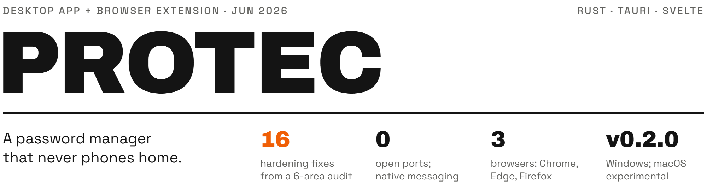

<picture>
  <source media="(max-width: 600px) and (prefers-color-scheme: dark)" srcset=".github/assets/header-phone-dark.png">
  <source media="(max-width: 600px) and (prefers-color-scheme: light)" srcset=".github/assets/header-phone-light.png">
  <source media="(prefers-color-scheme: dark)" srcset=".github/assets/header-dark.png">
  <source media="(prefers-color-scheme: light)" srcset=".github/assets/header-light.png">
  
</picture>

Protec is a fully local, open-source password manager: a Rust vault engine, a Tauri and Svelte desktop app, a browser extension for autofill and optional Windows Hello unlock. There is no account, no server and no telemetry; your secrets live in one encrypted file on your own machine and never leave it.

[Releases](https://github.com/damanjz/protec/releases) · [Portfolio page](https://damanjz.github.io/portfolio/projects/protec/)

## Results

| Figure | Result | How it is produced |
|---|---|---|
| 16 hardening fixes | From a six-area, self-run security audit of the whole codebase (not a third-party audit) | Merge commit [`a0534b2`](https://github.com/damanjz/protec/commit/a0534b2) on `main`, 2026-06-20; the fixes are listed under [Audit](#audit) |
| 0 open ports | The extension reaches the app over native messaging and a local pipe (named pipe on Windows, Unix domain socket on macOS); no network, no localhost server | `crates/protec-host` and `extension/`; see [Browser extension](#browser-extension) |
| 3 browsers | Autofill in Chrome, Edge and Firefox | `extension/manifest.chromium.json`, `extension/manifest.firefox.json` (Manifest V3) |
| v0.2.0 | Latest release, 2026-06-22: Windows installers (`.msi`, NSIS `.exe`) and an experimental universal macOS `.dmg` | [Releases](https://github.com/damanjz/protec/releases) |
| 110 Rust tests | All pass across the workspace (core 47, desktop app 54, host 6, Windows Hello 3) | `cargo test --workspace` on Windows 11, 2026-10-12 |

## How it works

| Part | What it does |
|---|---|
| `protec-core` | The vault engine. Argon2id derives a key from the master password; XChaCha20-Poly1305 encrypts the vault. |
| `protec-gui` (`src-tauri/`, `src/`) | The desktop app: Tauri 2 back end in Rust, Svelte and TypeScript front end. It holds the unlocked vault and gates every autofill request. |
| `protec-host` + `extension/` | The browser launches `protec-host` over native messaging; the host relays requests to the running app over a named pipe (Windows) or Unix domain socket (macOS). |
| `protec-hello` | Optional Windows Hello unlock with a non-exportable, machine-bound TPM key. Windows only. |

## Security model

- **Argon2id** key derivation; **XChaCha20-Poly1305** authenticated encryption.
- **Envelope encryption:** a random vault key encrypts your data; your master password only wraps that vault key, so new unlock methods (such as Windows Hello) need no re-encryption.
- **No cloud, no account, no telemetry.** A single encrypted file you control.
- Key material is wiped from memory on lock.
- The desktop app is the gatekeeper for autofill: it must be running and unlocked, it matches the page's registrable domain strictly (`github.com` never fills on `github.com.evil.com`), and every fill, save or update needs an explicit Allow in the app.
- Report vulnerabilities privately through GitHub Security Advisories; see [SECURITY.md](SECURITY.md).

## Audit

On 2026-06-20 the integrated system went through a self-run security audit across six areas in parallel. It found no critical exploitable issue (strict CSP, no XSS sink). Its 16 robustness, denial-of-service and defence-in-depth fixes were merged in [`a0534b2`](https://github.com/damanjz/protec/commit/a0534b2):

| Area | Fixes |
|---|---|
| Core (4) | Validate KDF parameters against hostile vault files; cap vault file size; bound generator length and word count; per-vault salt in the Windows Hello KDF |
| Desktop app (9) | Validate and lock down `vault_path` (reject UNC, device and relative paths; not settable from the webview); clamp auto-lock and clipboard timeouts; server-side entry timestamps; rate-limiter memory cap; IPC origin validation; propagate save errors; correlation nonce on `answer_confirm`; HTTPS-downgrade-resistant domain matching; clear the password field on a failed unlock |
| Extension (1) | Validate the message sender id |
| CI (2) | Pin `cargo-audit`; add `npm audit` |

This is not a third-party audit. None has been done yet ([SECURITY.md](SECURITY.md)).

## Browser extension

Protec autofills logins in Chrome, Edge and Firefox through **native messaging**: no network, no localhost server. The browser talks to a small local host (`protec-host`) that relays requests to the running desktop app over a Windows named pipe, or a Unix domain socket on macOS (`~/Library/Application Support/Protec/protec-ipc-v1.sock`). The desktop app must be running and unlocked for autofill to work.

## Windows Hello unlock

On devices with a TPM and Windows Hello configured, Protec can unlock with your fingerprint, face or PIN in addition to your master password. It is **opt-in** (enable it in Settings, or accept the offer when you first create your vault) and **additive**: your master password always still works. Hello uses a non-exportable, machine-bound TPM key; disabling it deletes that key. On devices without Hello, the option does not appear.

## Quick start

### Windows

Install a release: download the `.msi` or `-setup.exe` installer from [Releases](https://github.com/damanjz/protec/releases).

Build from source. Requirements: Rust (stable), Node.js (CI uses 20) and, on Windows, the WebView2 runtime (preinstalled on Windows 11). A debug build of the workspace takes about 2.5 GB in `target/`.

```bash
cargo install tauri-cli --version "^2" --locked   # one-time
npm install
cargo tauri dev        # run in development
cargo tauri build      # produce a Windows installer (.msi / NSIS)
cargo test --workspace # run the Rust tests
```

Always build the production binary with `cargo tauri build`, not `cargo build --release`: the Tauri CLI embeds the compiled front end, while a plain cargo build produces a binary that expects the dev server.

The app is keyboard-driven: press **Ctrl+K** for the command palette (search entries, generate passwords, switch theme, lock the vault). Auto-lock timeout, clipboard auto-clear, theme (Slate Dev-Tool / Terminal Green), generator defaults and the vault file location are all set in **Settings**. The vault lives at `%APPDATA%\Protec\vault.dat` by default; preferences are stored (without secrets) in `%APPDATA%\Protec\config.toml`.

### Browser extension (development install)

```bash
cargo build -p protec-host --release          # build the host
cd extension && npm install && npm run build  # build the extension
```

Load `extension/dist` (with the right manifest copied in as `manifest.json`) as an unpacked extension, then register the host from a normal PowerShell (no admin needed):

```powershell
extension\scripts\register-host.ps1 -HostExe "<repo>\target\release\protec-host.exe" -ChromiumExtId "<your-unpacked-extension-id>"
```

### macOS (experimental)

The macOS build is produced in CI and has **not** been verified by the maintainers on real hardware. Use it at your own risk and keep a backup of your vault. Touch ID unlock is not available on macOS yet: unlock with your master password.

1. Download `Protec_<version>_universal.dmg` from the latest [release](https://github.com/damanjz/protec/releases) (universal: runs on Apple Silicon and Intel).
2. Open the `.dmg` and drag **Protec** to **Applications**.
3. The app is unsigned, so Gatekeeper warns on first launch. Either right-click the app, choose **Open**, then **Open** in the dialog, or run `xattr -d com.apple.quarantine /Applications/Protec.app`.
4. Browser integration uses the local Unix domain socket, with the same gatekeeper and domain-matching rules as on Windows. Register the host with `extension/scripts/register-host-macos.sh /path/to/protec-host <chromium-ext-id>`.

Your vault lives at `~/Library/Application Support/Protec/vault.dat`; preferences (without secrets) at `~/Library/Application Support/Protec/config.toml`.

Build it yourself on a Mac:

```bash
cargo install tauri-cli --version "^2" --locked
npm install
cargo tauri build --target universal-apple-darwin   # unsigned universal .dmg
```

## Repo layout

```
protec/
├── crates/
│   ├── protec-core/     # vault engine: KDF, encryption, on-disk format
│   ├── protec-host/     # native-messaging host; relays to the app over a pipe or socket
│   └── protec-hello/    # Windows Hello unlock (TPM-held key), Windows only
├── src-tauri/           # desktop app back end (Tauri 2), crate protec-gui
├── src/                 # desktop app front end (Svelte, TypeScript, Vite)
├── extension/           # browser extension (Manifest V3), host registration scripts
├── docs/                # manual smoke-test lists for the desktop app and Windows Hello
├── .github/workflows/   # CI: core, desktop app, host, Hello, extension, macOS build, cargo audit
├── SECURITY.md          # how to report a vulnerability; audit status
└── LICENSE              # Apache-2.0
```

## Limits

- No third-party audit. The 16 fixes come from a self-run audit.
- macOS is experimental: unsigned, no Touch ID, never run by the maintainers on a real Mac.
- The extension is not in any browser store; it installs unpacked, as above.
- There is no command-line client; the planned `protec-cli` was dropped in favour of the desktop app.
- Windows Hello unlock is checked by hand only ([docs/protec-hello-smoke.md](docs/protec-hello-smoke.md)).

## Licence

Apache-2.0, see [LICENSE](LICENSE).
